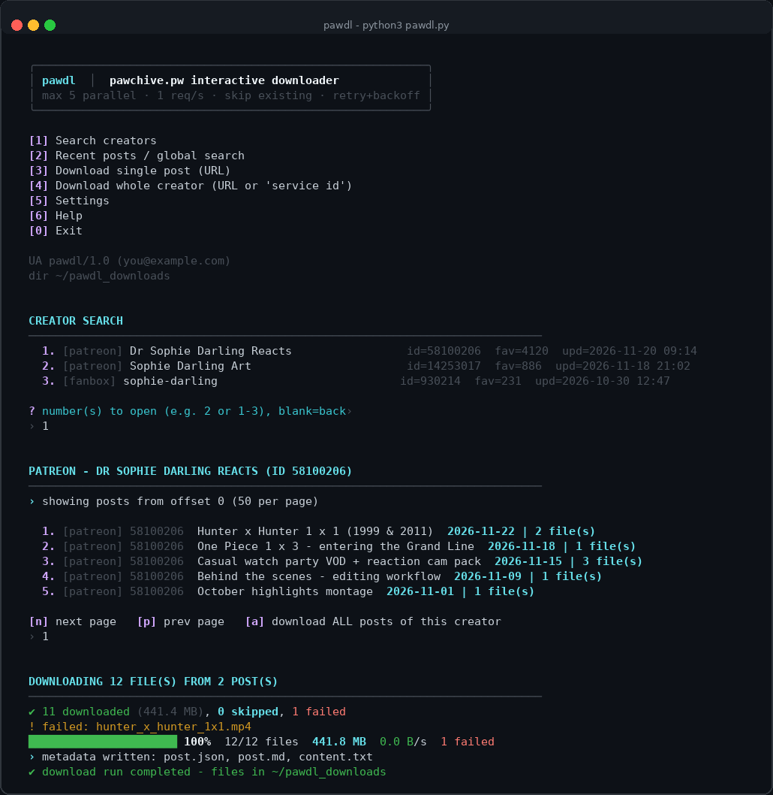

# 🐾 pawdl

  

An interactive command-line downloader for the public [pawchive.pw](https://pawchive.pw) archive API. Browse creators, search posts, and archive files with a terminal UI — using nothing but the Python standard library.



## ✨ Features

- 🖥️ **Interactive terminal UI** — ANSI-styled menus, rounded boxes, colored status output, and a live progress bar with percentage, file count, and transfer speed.
- 🔍 **Creator search** — search ~99k patreon/fanbox creators by name, public ID, or numeric ID, then browse their posts 50 per page with `[n]`/`[p]` paging.
- 🌐 **Global post search** — full-text search across the post index or browse recent uploads, 150 results per page.
- 🎯 **Single post download** — paste any post URL (`https://pawchive.pw/patreon/user/ID/post/POSTID`) and grab everything in it.
- 📚 **Whole-creator archiving** — queue every post of a creator from their page, or enter a creator URL / `service id` directly.
- ☑️ **Multi-select** — lists accept selections like `1,3-5 8`.
- 🗂️ **Complete file coverage** — regular attachments, deferred video attachments (temporary signed MP4 URLs), and inline `` images inside post bodies; preview-only thumbnails are skipped by default and can be toggled in Settings.
- 📝 **Metadata export** — every post is saved with `post.json`, `post.md`, and `content.txt` alongside its files.
- ⏯️ **Resume-friendly** — already-downloaded files are skipped automatically on re-runs, so you can interrupt and restart any job.
- 🔁 **Retries with backoff** — transient HTTP and network errors are retried automatically; hard failures (400/404) stop immediately.
- ⚡ **24-hour creator cache** — the ~16 MB creator index is downloaded once and cached locally with a configurable TTL.

## 📦 Installation

pawdl is a single Python script with zero third-party dependencies, so installing it is just a matter of getting the file onto your machine.

**1. Get Python**

Check that Python 3.8 or newer is available (macOS, most Linux distributions, and Windows all ship a build):

```sh
python3 --version
```

**2. Get the script**

Either clone the repository (replace `YOUR-USERNAME` with your GitHub account):

```sh
git clone https://github.com/Lunatic16/pawchive-downloader.git
cd pawchive-downloader
```

or grab only the script itself:

```sh
curl -O https://raw.githubusercontent.com/Lunatic16/pawchive-downloader/main/pawdl.py
```

**3. Run it**

```sh
python3 pawdl.py
```

**Optional — install onto your PATH**

To launch pawdl from anywhere with a single command:

```sh
sudo install -m 755 pawdl.py /usr/local/bin/pawdl
pawdl
```

On Windows without WSL, download `pawdl.py` and run it with `py pawdl.py` from PowerShell or CMD.

## 🚀 Quick start

```sh
python3 pawdl.py
```

The first run asks for an identifiable User-Agent (the file server requires one, for example `pawdl/1.0 (you@example.com)`) and a download folder. Everything is stored in `~/.config/pawdl/config.json`, which you can relocate with the `PAWDL_CONFIG_DIR` environment variable.

## 🧭 Menu overview

| Key | Action |
| --- | --- |
| `1` | Search creators and browse their posts |
| `2` | Recent posts / global post search |
| `3` | Download a single post by URL |
| `4` | Download a whole creator by URL or `service id` |
| `5` | Settings (User-Agent, folder, cache TTL, metadata toggles) |
| `6` | Help |
| `0` | Exit |

Post lists support multi-select (`1,3-5 8`), page navigation (`[n]` / `[p]`), and bulk download (`[a]`).

## 🤝 Server etiquette

pawchive.pw asks automated clients to behave politely, and pawdl enforces this by default:

- maximum of **5 parallel downloads**
- at least **1 second between file requests** (rate-limited globally across all workers)
- an **identifiable User-Agent** — browser strings and empty agents can be rejected with 403

Please do not disable or bypass these limits; abusive traffic gets IPs blocked and hurts the archive.

## 📥 Download behaviour

- Files land in `{download_dir}/{service}/{creator} ({id})/{date}_{title}/`.
- Metadata files (`post.json`, `post.md`, `content.txt`) are written into the same folder and can be toggled individually in Settings.
- Downloads use a global rate limiter, 5-worker thread pool, `.part` staging, and up to 4 retries with escalating backoff delays.
- Deferred video attachments are fetched directly from their signed temporary URLs; the video server does not support range resume, so an interrupted video restarts from the beginning on the next run.
- Inline images referenced in the post body are rewritten from thumbnail URLs to full-size originals and downloaded too.

## 🖥️ Terminal UI details

The interface auto-detects its capabilities and degrades gracefully:

- Colors are disabled automatically when output is not a terminal, when `NO_COLOR` is set, or when `TERM=dumb` — piped and logged output stays clean.
- Unicode box and bar glyphs fall back to plain ASCII (`+ - | # .`) on terminals that cannot encode them.
- On Windows, the classic console is switched to ANSI escape mode at startup.

## ⚙️ Settings reference

| Setting | Description | Default |
| --- | --- | --- |
| User-Agent | Contact identifier sent with every request | set on first run |
| Download folder | Root directory for all archived posts | `./pawdl_downloads` |
| Creators cache TTL | Hours before the creator index is re-fetched | 24 h |
| `save_post_json` | Raw API response per post | on |
| `save_content_txt` | Post body converted to plain text | on |
| `save_post_md` | Formatted Markdown summary per post | on |
| `download_inline_images` | Fetch images embedded in the post body | on |
| `download_preview_files` | Fetch preview-only thumbnails (often dead links) | off |

Settings can be changed in menu `[5]`; changes are written to the config file immediately.

## ⚠️ Disclaimer

This tool is intended for personal archiving of publicly accessible content. Respect the archive's terms of service, the file server's rate limits, and the rights of the original creators.

## 📄 License

Released under the [MIT License](LICENSE).
